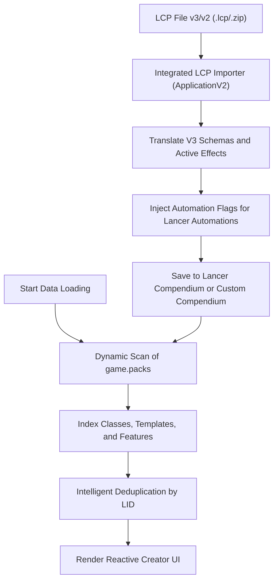

# Lancer NPC Creator

**Lancer NPC Creator** is an independent module for **Foundry VTT (compatible with Version 13)** developed using the new **ApplicationV2** architecture. It provides a reactive design interface for rapid creation of Non-Player Characters (NPCs) for the *Lancer* RPG system.

This tool integrates natively into Foundry VTT's Actor Directory, allowing Game Masters (GMs) to design and configure NPCs with dynamic stats adjusted by Tier and Templates, featuring real-time preview updates before spawning the actor in the world.

> [!IMPORTANT]
> **No Third-Party Content Included:** This module **does not** include any copyrighted, intellectual property, or third-party content (such as NPC stats, classes, or templates from the Lancer core books). It is a pure software utility. To function, it depends on external compendiums loaded from your active game system or other active modules (e.g., the `lancer-npcs-basico` module).

---

## Dynamic Compendium Discovery & LCP Import

The module dynamically loads data from **all active Item compendiums in Foundry VTT** containing NPC data (`npc_class`, `npc_template`, and `npc_feature`), with smart priority given to world compendiums and the module's custom compendium:

### 1. Native LCP Package Import (Comp/Con v3 and v2)
*   The module provides a built-in importer accessible directly via the **"Import LCP"** button in the creator interface or via the shortcut in the Actor directory.
*   **Full V3 Compatibility:** Modern Comp/Con v3 packages (split into `npcc_*.json`, `npct_*.json`, `eidolon_layers.json`, and using `active_effects`) are automatically translated into Foundry VTT-compatible item documents.
*   **Lancer Automations Integration:** Raw data for active effects, attack hooks, and resistances are saved in document flags (`flags['lancer-npc-import'].v3` and `flags['lancer-npc-creator'].v3`), allowing the [**Lancer Automations** module (by Agraael)](https://github.com/Agraael/lancer-automations) to instantly detect and automate them.

### 2. Dynamic Compendium Discovery
*   No longer tied to hardcoded pack names: any active pack in Foundry with `npc_class`, `npc_template`, or `npc_feature` is indexed automatically.
*   Translation packages (such as `lancer-npc-data-pt_BR.lcp`) and third-party expansion packs (Dustgrave, Wallflower, etc.) are consolidated by `lid`.

---

## How to Use

1. **Importing NPC Data (LCP):**
   * Open the NPC Creator or click the import shortcut in the Actor directory header.
   * Click **Import LCP** and select (or drag and drop) your desired `.lcp` or `.zip` file (e.g. `lancer-npc-data-pt_BR.lcp`).
   * Review the inspected contents (classes, templates, features) and click **Confirm & Import**.
   * The NPC Creator will reload immediately with all newly imported options!

2. **Opening the Creator:**
   * Go to the **Actors** tab in Foundry VTT's sidebar.
   * Click the **NPC Creator** button located at the top of the sidebar.

3. **Configuring your NPC:**
   * **Filter by Role:** Filter shown classes by combat roles (e.g., *Striker*, *Support*, *Defender*).
   * **Base Class:** Select the NPC class to act as the base chassis.
   * **Tier:** Choose the combat Tier (I, II, or III). The preview grid on the right updates base stats instantly.
   * **Apply Templates:** Toggle one or more templates (e.g., *Elite*, *Ultra*, *Veteran*) to apply cumulative bonuses to hit points, structure, stress, and activations.
   * **Optional Features:** Toggle additional optional features to customize the NPC's ability loadout.

4. **Spawning in World:**
   * Click **Generate NPC in World** in the preview panel.
   * The module will instantly create the actor in your sidebar, attach all selected items, and open the fully configured NPC sheet ready for action!

---

## Key Features and Business Rules

*   **Reactive Selection & Filtering:** Allows filtering NPC classes by their combat role (*Striker*, *Support*, *Defender*, etc.).
*   **Dynamic Tier Adjustments:** When changing the Combat Tier (I, II, or III), all base stats of the NPC are recalculated automatically according to the corresponding class's stat tables.
*   **Application of Templates with Cumulative Bonuses:** 
    *   Templates like **Elite**, **Ultra**, **Veteran**, **Commander**, and **Grunt** dynamically alter the character sheet.
    *   The UI adds bonuses for Structure, Stress, and extra Activations per round.
    *   The logic applies direct stat bonuses added by equipped features.
    *   Features support overrides, such as the **Grunt** template which automatically forces Hit Points (HP) to 1, and Structure/Stress to 0.
*   **Intelligent Optional Features:** As you select new templates or classes, the valid optional features for that specific combination are dynamically displayed in the left column for customization.
*   **Native V13 Integration (ApplicationV2):** The "NPC Creator" button is dynamically injected into the header of the Actor Directory in a way that is fully compatible with Foundry VTT's new API.
*   **World Instantiation:** The "Generate NPC in World" button instantly creates an actor of type `npc`, compiles all selected items (Class, Templates, and active Features) directly onto the actor's sheet, names it according to the configuration, and automatically opens the new sheet for the GM.

---

## Project Structure

*   `module.json`: The module manifest indicating the ESModule script dependency, CSS styles, compatibility with Foundry VTT V13+, definition of empty compendiums, package recommendations, and registered language files.
*   `scripts/npc-creator.mjs`: Contains all the reactive rendering logic, event listeners, dynamic NPC stat calculation via `game.i18n`, and smart compendium loading.
*   `scripts/lcp-import-dialog.mjs`: ApplicationV2 modal interface for uploading, inspecting, and importing LCP files with progress tracking.
*   `scripts/v3-lcp-shim.mjs`: Robust translation engine for Comp/Con v3 LCPs, active effect translation, and automation flag preservation.
*   `styles/npc-creator.css`: Modern and reactive styling inspired by *Lancer*'s tactical and futuristic interface.
*   `lang/`: Directory containing JSON translation files for the creator's dynamic localization:
    *   `pt-BR.json`: Portuguese Brazilian translation keys and terms.
    *   `en.json`: English translation keys and adapted game terminology.
*   `packs/custom-npc-features/`: Directory hosting the item compendium **`lancer-npc-creator.custom-npc-features`** ("NPC Creator - Custom Features") used to store imported and custom classes, templates, or features.

---

## Acknowledgements & Credits

This module integrates with and builds upon outstanding community tools for Lancer on Foundry VTT:
* **[Agraael/lancer-automations](https://github.com/Agraael/lancer-automations)**: The premier combat and item automation engine for the Lancer RPG system on Foundry VTT, created by **Agraael**. All v3 active effects, flags, and item modifications are designed to interoperate seamlessly with Lancer Automations.
* **[Agraael/Lancer-vtt-NPC-import](https://github.com/Agraael/Lancer-vtt-NPC-import-Macro)**: The Comp/Con v3 LCP translation logic (`v3-lcp-shim`) and schema normalization were adapted from the foundational work created by **Agraael**.

---

## Generative AI Content Declaration
This module was developed with the assistance of Generative AI tools (such as Antigravity by Google). For more details on the scope of assistance and compliance with Foundry VTT guidelines, please consult our [Generative AI Content Declaration](file:///c:/Users/lpfon/AppData/Local/FoundryVTT/Data/modules/lancer-npc-creator/GEN-AI-DECLARATION.md).
