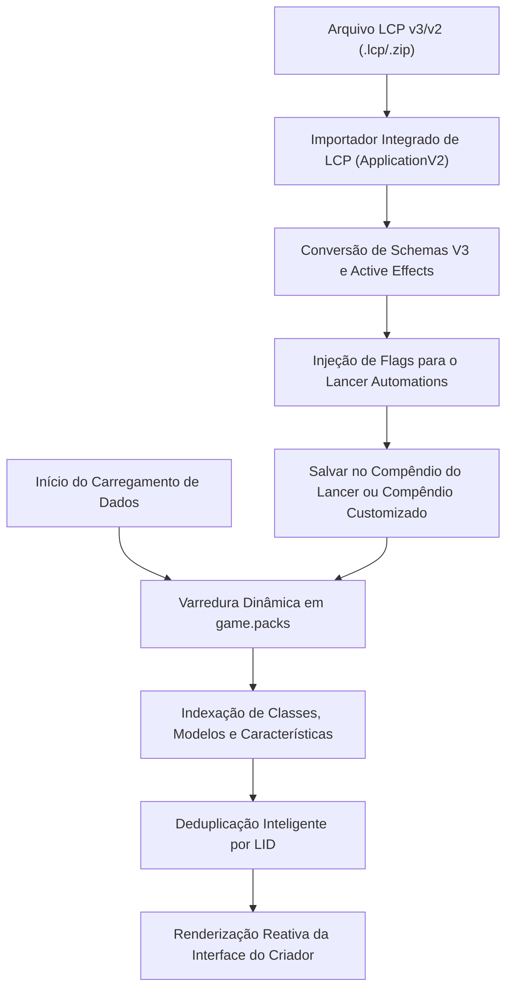

# Lancer NPC Creator 

O **Lancer NPC Creator** é um módulo independente para **Foundry VTT (compatível com a Versão 13)** desenvolvido utilizando a nova arquitetura **ApplicationV2**. Ele fornece uma interface reativa de design e criação rápida de Personagens Não-Jogadores (PNJs/NPCs) para o sistema de RPG *Lancer*.

Esta ferramenta se integra nativamente ao diretório de Atores (Actor Directory) do Foundry VTT, permitindo que Mestres de Jogo (GMs) criem e configurem PNJs com estatísticas dinâmicas ajustadas por Tier e Modelos (Templates), com atualização em tempo real antes da geração do ator no mundo.

> [!IMPORTANT]
> **Sem Conteúdo de Terceiros Incluso:** Este módulo **não contém** propriedade intelectual, regras protegidas por direitos autorais ou conteúdo de terceiros (como estatísticas, classes ou modelos de PNJs dos livros oficiais de Lancer). Ele é puramente uma ferramenta de software. Para funcionar, ele depende de compêndios externos carregados do seu sistema de jogo ativo ou de outros módulos (como o módulo `lancer-npcs-basico`).

---

## Como Funciona a Descoberta de Compêndios e Importação de LCPs

O módulo opera carregando dados dinamicamente de **todos os compêndios ativos no Foundry VTT** que contenham dados de PNJ (`npc_class`, `npc_template` e `npc_feature`), com prioridade inteligente para compêndios do mundo e o compêndio customizado do módulo:

### 1. Importação Nativa de Pacotes LCP (Comp/Con v3 e v2)
*   O módulo possui um importador nativo acessível diretamente pelo botão **"Importar LCP"** na interface do criador ou pelo atalho no diretório de atores.
*   **Compatibilidade V3 Completa:** Pacotes modernos do Comp/Con v3 (com divisão em `npcc_*.json`, `npct_*.json`, `eidolon_layers.json` e `active_effects`) são automaticamente convertidos e traduzidos para documentos de itens perfeitamente compatíveis com o Foundry VTT.
*   **Integração com Lancer Automations:** As informações brutas de efeitos ativos, gatilhos de ataque e resistências são salvas nas flags dos documentos (`flags['lancer-npc-import'].v3` e `flags['lancer-npc-creator'].v3`), garantindo que o módulo [**Lancer Automations** (por Agraael)](https://github.com/Agraael/lancer-automations) reconheça e automatize os itens instantaneamente.

### 2. Descoberta Dinâmica de Compêndios
*   O módulo não depende mais de nomes fixos de compêndios: qualquer compêndio ativo no Foundry que possua itens do tipo `npc_class`, `npc_template` ou `npc_feature` é indexado automaticamente.
*   Se você possuir um pacote de tradução (como o `lancer-npc-data-pt_BR.lcp`) ou pacotes de expansões de terceiros (Dustgrave, Wallflower, etc.), eles são detectados e consolidados por `lid`.

---

## Como Usar

1. **Importando Dados de PNJ (LCP):**
   * Abra o Criador de PNJ ou clique no ícone de importação no cabeçalho do diretório de Atores.
   * Clique em **Importar LCP** e selecione (ou arraste) o arquivo `.lcp` ou `.zip` desejado (por exemplo, `lancer-npc-data-pt_BR.lcp`).
   * Confira os dados inspecionados (quantidade de classes, templates e características) e clique em **Confirmar e Importar**.
   * O criador será atualizado imediatamente com todas as novas opções disponíveis!

2. **Abrindo o Criador:**
   * Acesse a aba **Atores (Actors)** na barra lateral do Foundry VTT.
   * Clique no botão **Criador de PNJ (NPC Creator)** localizado no topo da barra.

3. **Configurando o PNJ:**
   * **Filtrar por Função:** Se desejar, filtre as classes mostradas pelo seu papel de combate (ex: *Striker*, *Support*, *Defender*).
   * **Classe Base:** Selecione a classe do PNJ que servirá como base do chassi.
   * **Patamar (Tier):** Escolha o Patamar de combate (I, II ou III). A grade de atributos do lado direito será recalculada automaticamente na hora.
   * **Aplicar Modelos (Templates):** Ative um ou mais modelos (como *Elite*, *Ultra*, *Veterano*) para adicionar bônus cumulativos de vida, estrutura, estresse e ativações à criatura.
   * **Características Opcionais:** Selecione características opcionais na lista para customizar o conjunto de habilidades do PNJ.

4. **Gerando no Mundo:**
   * Clique em **Gerar PNJ no Mundo** na coluna de preview.
   * O módulo irá gerar instantaneamente o ator na sua barra lateral, anexar todos os itens e abrir a ficha de PNJ completa pronta para o combate!

---

## Principais Funcionalidades e Regras de Negócio

*   **Seleção e Filtragem Reativa:** Permite filtrar classes de PNJ pela sua função em combate (*role*) como *Striker*, *Support*, *Defender*, etc.
*   **Ajuste Dinâmico de Patamar (Tier):** Ao alterar o Patamar (I, II ou III), todos os atributos base do PNJ são recalculados automaticamente de acordo com as tabelas de atributos da classe correspondente.
*   **Aplicação de Modelos (Templates) com Bônus Cumulativos:** 
    *   Modelos como **Elite**, **Ultra**, **Veterano**, **Comandante** e **Peão** alteram dinamicamente a ficha.
    *   A interface adiciona bônus de Estrutura, Estresse e Ativações adicionais na rodada.
    *   A lógica aplica bônus diretos em estatísticas adicionados por características equipadas.
    *   Possui suporte a sobrescritas (*overrides*), como o modelo **Peão** que força automaticamente os Pontos de Vida (PV) para 1, e Estrutura/Estresse para 0.
*   **Características Opcionais Inteligentes:** Conforme você seleciona novos modelos ou classes, as características opcionais válidas para aquela combinação são exibidas dinamicamente na coluna esquerda para personalização.
*   **Integração Nativa V13 (ApplicationV2):** O botão "Criador de PNJ" é injetado dinamicamente no cabeçalho do diretório de Atores de forma compatível com a nova API do Foundry VTT.
*   **Instanciação no Mundo:** O botão "Gerar PNJ no Mundo" cria instantaneamente um ator do tipo `npc`, compila todos os itens (Classe, Modelos e Características selecionadas) diretamente na ficha do ator, nomeia-o de acordo com a configuração e abre a nova ficha automaticamente para o Mestre.

---

## Estrutura do Projeto

*   `module.json`: Manifesto do módulo indicando a dependência do script ESModule, estilos CSS, compatibilidade com o Foundry VTT V13+, definição do compêndio vazio, recomendação de pacotes e registro de idiomas suportados.
*   `scripts/npc-creator.mjs`: Contém toda a lógica de renderização reativa, listeners de eventos, cálculo dinâmico de atributos do PNJ com `game.i18n` e carregamento inteligente dos compêndios.
*   `styles/npc-creator.css`: Estilização moderna e reativa inspirada na interface futurista e tática do *Lancer*.
*   `lang/`: Diretório contendo os arquivos JSON de tradução para a localização dinâmica do criador:
    *   `pt-BR.json`: Tradução e chaves originais em Português do Brasil.
    *   `en.json`: Tradução e chaves completas adaptadas em Inglês.
*   `packs/custom-npc-features/`: Diretório que hospeda o compêndio vazio de itens **`lancer-npc-creator.custom-npc-features`** ("Criador de PNJ - Características Customizadas") disponível nativamente para ser preenchido pelo usuário com suas próprias classes, modelos ou características customizadas.

---

## Créditos e Agradecimentos

Este módulo utiliza e integra tecnologias da comunidade Lancer Foundry VTT:
* **[Agraael/lancer-automations](https://github.com/Agraael/lancer-automations)**: Módulo de automações avançadas para o sistema Lancer no Foundry VTT desenvolvido por **Agraael**. Toda a compatibilidade com efeitos ativos, bônus dinâmicos e flags de dados v3 foi projetada para interoperar perfeitamente com este sistema.
* **[Agraael/Lancer-vtt-NPC-import](https://github.com/Agraael/Lancer-vtt-NPC-import-Macro)**: O motor de tradução de LCPs Comp/Con v3 (`v3-lcp-shim`) e normalização de esquemas de dados foi baseado e adaptado diretamente do trabalho de **Agraael**.

---

## Declaração de Uso de IA / Generative AI Declaration
Este módulo foi desenvolvido com o auxílio de ferramentas de IA Generativa (como o Antigravity desenvolvido pela Google). Para mais detalhes sobre o escopo e conformidade com as diretrizes do Foundry VTT, consulte a nossa [Declaração de Conteúdo de IA Generativa](file:///c:/Users/lpfon/AppData/Local/FoundryVTT/Data/modules/lancer-npc-creator/GEN-AI-DECLARATION.md).
